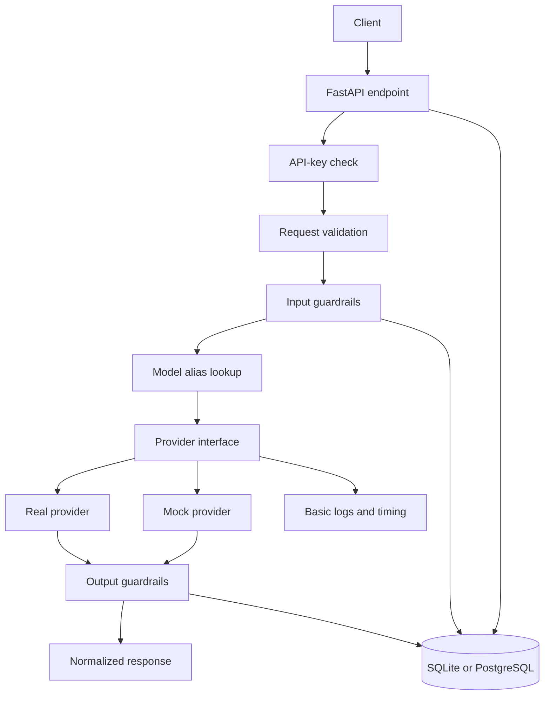

# SecureLLM Gateway — Product Specification (Resume MVP)

**Document type:** Product requirements specification  
**Project level:** Resume-ready MVP  
**Status:** Proposed  
**Related document:** `technical-plan.md` (update it to match this reduced scope)

---

## 1. Product overview

### 1.1 One-line description

**SecureLLM Gateway** is a lightweight API gateway that routes chat requests to a configured LLM provider and applies input/output guardrails before returning a response.

### 1.2 Problem

Applications integrating LLMs often repeat provider integration, sensitive-data handling, and output validation logic. This project centralizes those responsibilities behind one small HTTP API so client applications can call a single endpoint and receive consistent behavior.

### 1.3 Goal

Deliver a clean, tested backend project demonstrating:
- REST API design and request validation.
- LLM provider integration behind a small adapter interface.
- Practical input and output guardrails.
- Basic authentication, error handling, and rate limiting.
- Request usage/history persistence.
- Automated testing and clear technical documentation.

This is a portfolio MVP, not an enterprise LLM platform.

---

## 2. Scope

### 2.1 Must-have features

1. A unified chat endpoint.
2. One real LLM provider integration.
3. A deterministic mock provider for demos and tests.
4. Logical model aliases such as `default` mapped to configured provider/model settings.
5. Input validation and maximum request-size limits.
6. Email and phone-number detection with optional redaction.
7. Simple, high-confidence prompt-injection pattern checks.
8. Output checks for configured prohibited patterns or synthetic secret canaries.
9. API-key authentication.
10. A simple per-key request rate limit.
11. Basic request metadata and usage history.
12. Consistent safe error responses.
13. Automated unit and API tests.
14. README, example requests, and local setup instructions.

### 2.2 Defer these features

These are explicitly **not required** for the resume MVP:
- Multi-tenancy and complex organization/project hierarchies.
- SSO, SCIM, detailed enterprise RBAC, or a visual admin dashboard.
- Multiple live provider integrations; one real provider plus a mock is enough.
- Complex model routing, adaptive routing, circuit breakers, and elaborate retry policies.
- Redis and distributed rate limiting.
- Kubernetes, multi-region deployment, and high availability.
- Separate guardrail microservices.
- Full Prometheus/Grafana/OpenTelemetry infrastructure.
- Automated billing or guaranteed exact cost accounting.
- Streaming, images/audio, tool calling, and full compatibility with every provider API feature.
- A claim that all prompt injections, harmful outputs, or secret leaks can be detected.
- Human-review workflows or advanced policy lifecycle management.

**Scope rule:** only add a feature if the core request path and its tests are already complete.

---

## 3. Users and core use cases

### Developer integrating an LLM
Wants one API call that includes basic validation and safety checks.

### Project maintainer
Wants to configure a model, protect the endpoint with an API key, and inspect basic request usage.

### Required scenarios
- Send a normal chat request through the gateway.
- Select a configured logical model alias.
- Reject a request without valid authentication.
- Redact a synthetic email or phone number before provider invocation.
- Block a request matching a configured high-confidence pattern.
- Block a generated response containing a synthetic secret canary.
- Return a safe error if the provider fails or times out.
- Inspect usage metadata without storing raw prompts or completions.
- Run tests without a real provider API key.

---

## 4. Recommended technology stack

| Area | Recommended choice | Reason |
|---|---|---|
| Language | Python 3.12+ | Strong ecosystem and type support |
| API | FastAPI | Simple HTTP API and generated Swagger docs |
| Validation | Pydantic | Request, response, and configuration validation |
| Provider | One official provider SDK | Avoid unnecessary integration complexity |
| Mocking | Internal mock adapter | Deterministic demos and tests |
| Database | SQLite for simplicity; PostgreSQL if desired | Store safe request metadata |
| Database layer | SQLAlchemy, optional for a tiny implementation | Persistence abstraction |
| PII detection | Regex for email/phone first; optional Presidio | Lightweight starting point |
| Tests | pytest + FastAPI TestClient/HTTPX | Unit and API-level tests |
| Local environment | Docker Compose optional | Reproducible setup |
| Logging | Python logging with structured fields | Basic troubleshooting |

### Stack guidance
- Choose SQLite if the priority is finishing quickly. PostgreSQL is a reasonable choice if you want to demonstrate relational database experience.
- Do not add Redis for the first version; use an in-process rate limiter and document that it is single-instance only.
- Do not require a monitoring stack.
- Keep provider secrets in environment variables. Never commit real keys.
- The mock provider must work without external credentials.

---

## 5. Functional requirements

### FR-1 — Chat API

Expose `POST /v1/chat/completions`.

Request fields:
- Logical model alias.
- List of messages with supported roles and text content.
- Optional supported generation settings such as temperature and maximum output tokens.

Response fields:
- Request ID.
- Selected logical model alias.
- Assistant response.
- Token usage when returned by the provider.
- Finish reason when available.

Validate inputs and explicitly reject unsupported features such as streaming rather than silently ignoring them.

### FR-2 — Provider abstraction

Create a small internal provider interface so the gateway's orchestration code does not depend directly on a vendor SDK.

Implement:
- One real provider adapter.
- One deterministic mock adapter.

The mock adapter should support predictable success, simulated failure/timeout, and a configured unsafe response for tests.

### FR-3 — Model aliases

The client sends a logical alias such as `default`. Server-side configuration maps it to a provider and model identifier.

Requirements:
- Unknown aliases return a clear client error.
- Clients cannot override provider credentials or select arbitrary provider models.
- One configured alias is sufficient for the initial demo.
- One optional fallback target is a stretch goal, not a requirement.

### FR-4 — Input guardrails

Before a provider call:
- Validate the message structure and supported roles.
- Enforce a maximum request size.
- Run enabled input checks.
- Record safe decision metadata.

Initial checks:
- Email pattern detection.
- Phone-number pattern detection.
- High-confidence prompt-injection heuristics.
- Optional configured prohibited patterns.

Actions: `allow`, `redact`, or `block`.

Pattern-based injection checks are only a basic defense-in-depth measure; do not claim complete detection.

### FR-5 — PII redaction

When enabled:
- Replace detected values with placeholders such as `[REDACTED_EMAIL]` or `[REDACTED_PHONE]`.
- Send the transformed content to the provider.
- Do not log the original sensitive value.
- Record that redaction occurred and which category was detected.

### FR-6 — Output guardrails

Inspect the generated response before returning it.

- If a configured blocking pattern matches, do not return the rejected response.
- Return a safe policy error with the request ID.
- Do not include matched content in the error or ordinary logs.
- Use a synthetic canary secret in the demo to prove output checking is active.

Simple pattern checks do not provide comprehensive semantic safety.

### FR-7 — Authentication

Require a gateway API key for the public chat endpoint.

Minimum implementation:
- Missing or invalid keys return `401 Unauthorized`.
- For the simplest version, the key may be configured through an environment variable.
- Database-backed key creation/revocation is a stretch goal.
- Any admin/configuration endpoints must be separately protected.
- Never log API keys or provider credentials.

### FR-8 — Rate limiting

Implement a configurable per-key request limit, for example requests per minute.

- Exceeding the limit returns `429 Too Many Requests`.
- Return a safe error code and request ID.
- Test limit enforcement and reset behavior.

An in-memory limiter is acceptable for this single-instance MVP. It is not a distributed limiter.

### FR-9 — Usage history

Persist basic metadata when feasible:
- Request ID and timestamp.
- Logical model alias.
- Outcome/status and duration.
- Input/output token counts when available.
- Approximate cost only if usage and pricing configuration are available.
- Guardrail action and check IDs.

Do not store raw prompts or completions by default. Label cost as an estimate, not a billable amount. If usage is unavailable, leave token counts unknown rather than inventing them.

### FR-10 — Error handling

Use one error format:

```json
{
  "error": {
    "code": "INPUT_BLOCKED",
    "message": "The request was blocked by the configured policy.",
    "request_id": "req_example"
  }
}
```

Handle invalid requests, authentication failures, unknown aliases, input/output blocks, rate limits, provider errors, and timeouts. Never return raw SDK errors, stack traces, credentials, or matched sensitive content.

### FR-11 — Health and documentation

Provide:
- `GET /health`
- FastAPI Swagger/OpenAPI documentation.
- README with setup, environment variables, example requests, tests, architecture, and known limitations.

---

## 6. Non-functional requirements

### Security
- Store provider credentials in environment variables.
- Do not commit `.env` files or real keys.
- Do not log authorization headers or raw sensitive content.
- Input blocking must happen before provider invocation.
- Output blocking must happen before returning a response.
- Use synthetic test data.

### Reliability
- Set a finite provider timeout.
- Normalize provider errors.
- Keep retry behavior minimal and bounded; one optional retry is enough.
- Ensure exceptions cannot bypass output checks.

### Maintainability
- Separate API routes, provider adapters, guardrails, and persistence into small modules.
- Use type hints and validated settings.
- Keep orchestration testable without starting an HTTP server.
- Avoid empty modules and premature abstractions.

### Performance
This is not a production performance benchmark. Use the mock provider to measure a basic latency baseline if time permits; do not claim production throughput or latency guarantees.

### API compatibility
Document the supported chat request subset. Streaming, multimodal input, and tool calls should return explicit unsupported-feature errors until implemented.

---

## 7. High-level architecture



### Request lifecycle
1. Generate a request ID.
2. Authenticate the gateway API key.
3. Validate the payload and enforce request-size limits.
4. Apply the rate limit.
5. Resolve the model alias.
6. Run input guardrails.
7. If blocked, return a safe error without calling the provider.
8. Call the provider with a finite timeout.
9. Run output guardrails.
10. If blocked, discard the generated output and return a safe error.
11. Record safe metadata and available usage.
12. Return the normalized response.

---

## 8. Minimal data model

If a database is used, begin with two tables.

### `model_configs`
- `id`
- `alias` (unique)
- `provider`
- `provider_model`
- `enabled`

Do not store raw provider API keys in this table.

### `request_logs`
- `id` / `request_id`
- `created_at`
- `model_alias`
- `status`
- `duration_ms`
- `input_tokens` (nullable)
- `output_tokens` (nullable)
- `estimated_cost` (nullable)
- `guardrail_action` (nullable)
- `error_code` (nullable)

Do not include prompt or completion text by default.

### Optional stretch table: `gateway_api_keys`
Add only if database-backed key management is implemented:
- `id`
- `name`
- `key_prefix`
- `key_hash`
- `created_at`
- `revoked_at`

A single environment-configured gateway key is acceptable for the first version.

---

## 9. Minimal API surface

| Method | Endpoint | Priority | Purpose |
|---|---|---|---|
| POST | `/v1/chat/completions` | Must | Main gateway request |
| GET | `/health` | Must | Basic health check |
| GET | `/v1/models` | Should | List configured aliases |
| GET | `/v1/usage` | Should | Recent safe usage records |

Keep admin APIs out of the first version unless genuinely needed. Model configuration can initially live in validated settings or a small configuration file.

---

## 10. Testing requirements

Tests are a major part of the project's resume value. Prioritize proof that guardrails control provider invocation and response delivery.

### Must-have tests
- Valid request succeeds using the mock provider.
- Missing/invalid API key is rejected.
- Invalid payload is rejected before provider invocation.
- Unknown model alias is rejected.
- Email and phone patterns are redacted when configured.
- Blocking input never invokes the provider.
- Unsafe mock output is not returned to the client.
- Provider timeout returns a normalized error.
- Rate limit returns 429 after the configured threshold.
- Usage metadata is recorded without raw prompt/completion content.
- Logs and errors do not expose credentials or synthetic sensitive values.

### Test approach
- Unit-test guardrail decisions, redaction, alias lookup, and error mapping.
- Test endpoints with FastAPI TestClient/HTTPX.
- Use the mock provider so CI does not need external API access.
- Maintain a small synthetic corpus of benign text, PII examples, injection patterns, and unsafe-output canaries.
- Include known limitations and false-positive cases instead of claiming perfect detection.

---

## 11. Delivery plan

Target roughly **2–3 weeks**, depending on experience and available time.

### Phase 1 — API skeleton
- Create repository and FastAPI app.
- Add settings, health endpoint, request/response schemas, and error format.
- Implement mock provider.

**Exit criteria:** the endpoint returns a deterministic mock completion and basic API tests pass.

### Phase 2 — Real provider and aliases
- Add one real provider adapter.
- Read credentials from environment variables.
- Add logical alias lookup and finite timeouts.
- Normalize provider errors.

**Exit criteria:** the same endpoint works with either mock or real provider by configuration.

### Phase 3 — Guardrails
- Add request-size validation.
- Implement email/phone detection and redaction.
- Add high-confidence injection-pattern blocking.
- Add output canary checks.
- Prove that blocked inputs do not reach the provider and blocked outputs do not reach clients.

**Exit criteria:** critical guardrail tests pass.

### Phase 4 — Authentication, rate limits, and usage
- Add gateway API-key validation.
- Add a simple per-key rate limiter.
- Persist request metadata and available usage.
- Add `/v1/usage` if time permits.

**Exit criteria:** auth, rate limits, and usage behavior are tested.

### Phase 5 — Polish and demo
- Write README and API examples.
- Add `.env.example` with placeholders.
- Add Docker support if useful.
- Add a demo script and architecture diagram.
- Run all tests from a clean checkout.
- Document limitations and future work.

**Exit criteria:** a reviewer can run the project and reproduce the main scenarios without assistance.

### If time is tight, prioritize
1. Mock-provider API path.
2. One real provider adapter.
3. Input/output guardrails with tests.
4. API-key check and safe errors.
5. Usage history.
6. Rate limiting.
7. Docker and presentation polish.

---

## 12. Demo acceptance checklist

- [ ] A normal chat request returns a response.
- [ ] The gateway can use mock mode without credentials.
- [ ] One real provider works when configured.
- [ ] Missing/invalid API key returns 401.
- [ ] Synthetic email/phone values are redacted before provider invocation.
- [ ] A configured injection-pattern request is blocked before provider invocation.
- [ ] An unsafe mock output is blocked before it reaches the client.
- [ ] Provider timeout/failure returns a safe error.
- [ ] Exceeding the request limit returns 429.
- [ ] Usage metadata can be inspected without raw prompt/completion storage.
- [ ] Tests run without a real provider API key.

---

## 13. Resume and portfolio presentation

### Suggested resume bullet

Use this only after the listed functionality is implemented:

> Built **SecureLLM Gateway**, a FastAPI-based LLM middleware service with provider abstraction, model aliases, PII redaction, prompt-injection pattern checks, output validation, API-key authentication, and usage tracking; added automated tests verifying that blocked inputs never reach the model and unsafe outputs are not returned to clients.

Only add metrics after measuring actual results. Do not claim production scale, comprehensive prompt-injection prevention, exact billing, or enterprise readiness.

### Repository checklist
- Clear README and architecture diagram.
- Short, reproducible local setup.
- `.env.example` with placeholders only.
- Example `curl` request and response.
- Mock mode that works without credentials.
- Focused tests demonstrating guardrail behavior.
- “Limitations and future work” section.
- No committed API keys or real user data.

---

## 14. Future extensions — not MVP requirements

Only consider these after all acceptance criteria pass:
- Database-backed API-key creation and revocation.
- PostgreSQL migration if the project starts with SQLite.
- A second real provider and a tested fallback path.
- Redis-backed distributed rate limiting.
- Policy versioning and a small admin API.
- Presidio-based PII recognition.
- Optional moderation/classifier adapter.
- Streaming support.
- Prometheus metrics and OpenTelemetry traces.
- Cloud deployment.

---

## 15. Final scope statement

The goal is **not** to recreate an enterprise LLM platform. The goal is to deliver a clean, tested backend project that demonstrates the essential flow:

**One gateway API → validate and guard the input → select a configured model → call the provider → guard the output → return a safe response and record basic usage.**

Build this end-to-end path first. Add complexity only when the working MVP and its tests justify it.
